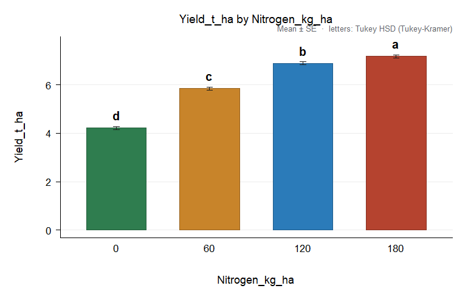
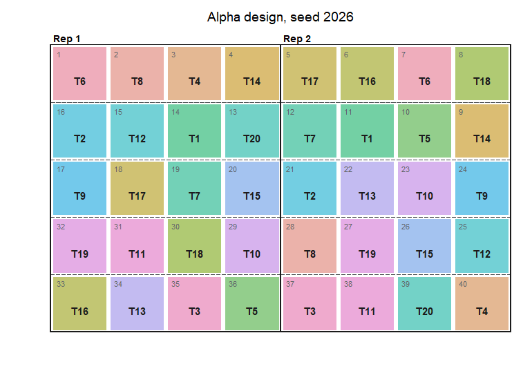

<!-- README.md is generated from README.Rmd: edit this file and knit it -->

# AgriDesign 

**Design and analysis of agricultural experiments in R.**

AgriDesign plans and analyses field, greenhouse and laboratory
experiments with the classical designs of agricultural research. It
tests every term of an analysis of variance against the right error
stratum, checks the assumptions, separates means with letters, draws
publication figures, writes an HTML report and randomises field layouts.
It also covers incomplete block designs with recovery of inter-block
information, plant breeding analyses (AMMI, stability, line x tester,
diallels, North Carolina designs) and plant pathology tools (AUDPC,
AUDPS). It is written in base R only and depends on no other package.

## Installation

``` r
# development version
# install.packages("remotes")
remotes::install_github("luisangelbg/AgriDesign-R")
```

## A first analysis

Maize yield under four nitrogen rates in a randomised complete block
design:

``` r
library(AgriDesign)
fit <- design_anova(maize_nitrogen, "Yield_t_ha", "Nitrogen_kg_ha", block = "Block")
fit
#> 
#> Randomised complete block design (RCBD)
#> Response: Yield_t_ha   (n = 16)
#> Type III sums of squares
#> 
#>                Df  Sum Sq Mean Sq F value    Pr(>F)    
#> Block           3  1.0691 0.35637   21.69 1.864e-04 ***
#> Nitrogen_kg_ha  3 21.5509 7.18362  437.27 4.591e-10 ***
#> Residuals       9  0.1479 0.01643                      
#> ---
#> Signif. codes:  0 '***' 0.001 '**' 0.01 '*' 0.05 '.' 0.1 ' ' 1
#> 
#> Grand mean = 6.03188   CV = 2.12 %   R-squared = 0.9935
```

Are the assumptions met?

``` r
check_assumptions(fit)
#> 
#> Assumptions of the ANOVA for Yield_t_ha (alpha = 0.05)
#> 
#>  Check        Test                        Statistic    df    p      Rating
#>  normality    Shapiro-Wilk                W = 0.9304         0.2477 ok    
#>  normality    Anderson-Darling            A2 = 0.4947        0.1840       
#>  normality    Jarque-Bera                 JB = 2.303   2     0.3162       
#>  variances    Levene (median)             F = 0.5348   3, 12 0.6672 ok    
#>  variances    Levene (mean)               F = 4.27     3, 12 0.0287       
#>  variances    Bartlett                    K2 = 0.1708  3     0.9822       
#>  variances    Fligner-Killeen             X2 = 1.314   3     0.7259       
#>  variances    Hartley Fmax                Fmax = 1.549                    
#>  additivity   Tukey one-degree-of-freedom F = 0.0548   1, 8  0.8208 ok    
#>  extremes     |studentized residual| > 3  count = 0                 ok    
#>  independence Durbin-Watson (data order)  d = 2.451                 ok    
#> 
#> Observations with |studentized residual| > 2.5:
#>  row group observed fitted studentized
#>   16   180     7.31  7.056       2.646
#> 
#> Grade A. Assumptions satisfied. Proceed with the analysis of variance on this scale.
```

Which rates differ?

``` r
cmp <- compare_means(fit, "Nitrogen_kg_ha", method = "tukey")
cmp
#> 
#> Tukey HSD (Tukey-Kramer), alpha = 0.05
#> Response: Yield_t_ha   compared: Nitrogen_kg_ha
#> Error: Residual error (MS = 0.01643, df = 9)
#> Minimum significant difference = 0.2829
#> 
#>  Nitrogen_kg_ha n  mean      se raw_mean     sd group
#>             180 4 7.182 0.06409    7.183 0.2943     a
#>             120 4 6.885 0.06409    6.885 0.3663     b
#>              60 4 5.845 0.06409    5.845 0.2978     c
#>               0 4 4.215 0.06409    4.215 0.3101     d
#> 
#> Means sharing a letter do not differ.
plot(cmp)
```



The response to nitrogen is quadratic, with its maximum near 180 kg/ha:

``` r
trend(fit, "Nitrogen_kg_ha")
#> 
#> Trend analysis of Yield_t_ha on Nitrogen_kg_ha (error: Residual error)
#> 
#>  component coefficients        ss         F df_error         p
#>     Linear -3, -1, 1, 3 19.770661 1203.4388        9 6.788e-11
#>  Quadratic 1, -1, -1, 1  1.775556  108.0780        9 2.587e-06
#>      Cubic -1, 3, -3, 1  0.004651    0.2831        9 6.075e-01
#> 
#> Highest significant component: quadratic.
#> Fitted response: y = 4.207 + 0.03323 x - 9.253e-05 x^2   R-squared = 0.946
#> Maximum response at x = 179.5 (y = 7.19); at the edge of the levels tested
```

A complete report, with a methods paragraph ready to adapt, the tables
and the figures, in one HTML file:

``` r
design_report(fit, "maize-report.html", title = "Nitrogen rates in maize", units = "t/ha")
```

## Split-plots and other multi-stratum designs

Each term is tested against its own error: irrigation (main plots)
against Error a, varieties and the interaction against Error b. Simple
effects use the pooled error with Satterthwaite degrees of freedom:

``` r
sp <- design_anova(split_irrigation, "Yield_t_ha", c("Irrigation", "Variety"),
                   block = "Block", design = "split_rcbd")
sp
#> 
#> Split-plot in RCBD (main plots in blocks)
#> Response: Yield_t_ha   (n = 24)
#> Type III sums of squares
#> 
#>                     Df   Sum Sq   Mean Sq  F value    Pr(>F)    
#> Block                2 0.452575 0.2262875   300.05 3.322e-03  **
#> Irrigation           1 7.889067 7.8890667 10460.64 9.558e-05 ***
#> Error a (main plot)  2 0.001508 0.0007542                       
#> Variety              3 4.836800 1.6122667  3269.95 9.749e-18 ***
#> Irrigation:Variety   3 0.098733 0.0329111    66.75 9.343e-08 ***
#> Error (residual)    12 0.005917 0.0004931                       
#> 
#> Tested against a higher error stratum:
#>   Block vs Error a (main plot)
#>   Irrigation vs Error a (main plot)
#> ---
#> Signif. codes:  0 '***' 0.001 '**' 0.01 '*' 0.05 '.' 0.1 ' ' 1
#> 
#> Grand mean = 7.985   CV = 0.28 %   R-squared = 0.9996
compare_means(sp, "Irrigation", by = "Variety")
#> 
#> Tukey HSD (Tukey-Kramer), alpha = 0.05
#> Response: Yield_t_ha   compared: Irrigation within each level of Variety
#> Error: pooled error [(b-1)Eb + Ea]/b with Satterthwaite df (MS = 0.0005583, df = 10.69)
#> Minimum significant difference = 0.04262
#> 
#>  Variety Irrigation n  mean      se raw_mean     sd group
#>       V1       Drip 3 8.387 0.01282    8.387 0.1823     a
#>       V1     Furrow 3 7.277 0.01282    7.277 0.1823     b
#>       V2       Drip 3 9.123 0.01282    9.123 0.1716     a
#>       V2     Furrow 3 7.900 0.01282    7.900 0.1411     b
#>       V3       Drip 3 7.810 0.01282    7.810 0.1706     a
#>       V3     Furrow 3 6.853 0.01282    6.853 0.1320     b
#>       V4       Drip 3 8.913 0.01282    8.913 0.1818     a
#>       V4     Furrow 3 7.617 0.01282    7.617 0.1861     b
#> 
#> Means sharing a letter do not differ (letters valid within each level).
```

## Planning a trial

``` r
lay <- make_design("alpha", trt = 20, k = 4, r = 2, seed = 2026, arrangement = "side")
design_efficiency(lay)[c("E", "upper_bound")]
#> $E
#> [1] 0.6769596
#> 
#> $upper_bound
#> [1] 0.7037037
plot(lay)
```



``` r
power_design(cv = 12, diff = 15, t = 20)$replicates
#> [1] 11
```

## What is in the package

| Area | Functions |
|----|----|
| Analysis of variance | `design_anova()` (16 designs, covariates, transformations), `ls_means()`, `designs()` |
| Assumptions | `check_assumptions()`, `transformations()`, `box_cox()` |
| Means | `compare_means()` (Tukey, LSD, Bonferroni, Sidak, Holm, Duncan, SNK, REGWQ, Scheffe, Dunnett, Games-Howell; simple effects), `waller_duncan()`, `trend()`, `test_contrasts()` |
| Rank-based tests | `nonparametric()` (Kruskal-Wallis, Welch, Friedman, Scheirer-Ray-Hare, aligned ranks), `durbin_test()`, `waerden_test()`, `median_test()` |
| Incomplete blocks | `recover_interblock()` (REML), `design_efficiency()` |
| Planning | `make_design()` (16 designs, listed by `designs("layout")`), `field_book()`, `power_design()` |
| Plant breeding | `ammi()`, `stability()`, `line_tester()`, `diallel()`, `nc_design()` |
| Plant pathology | `audpc()`, `audps()`, `audpc_by_unit()`, `smith_index()`, `hatheway_size()` |
| Figures and report | `plot()` methods, `plot_interaction()`, `plot_differences()`, `plot_cell_means()`, `plot_ss_partition()`, `plot_field()`, `save_figure()`, `design_report()` |

## Validation

Every statistic is compared with an independent implementation (base R,
established packages, published examples and closed-form results) in the
scripts of the `validation/` folder of the source repository. See the
article *Validation* for the list of comparisons and for the differences
found with other software.

## Citation

    Barrera-Guzmán L (2026). _AgriDesign: Design and Analysis of Agricultural Experiments_. R
    package version 1.0.0, <https://github.com/luisangelbg/AgriDesign-R>.

## Licence

GPL (\>= 3)
