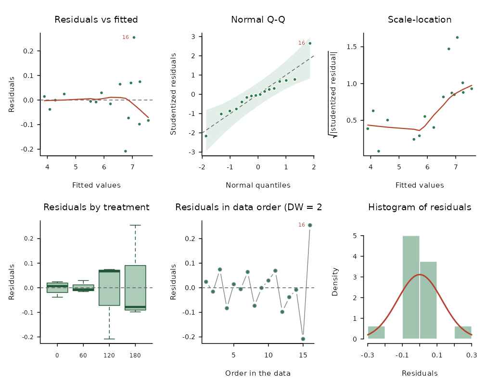
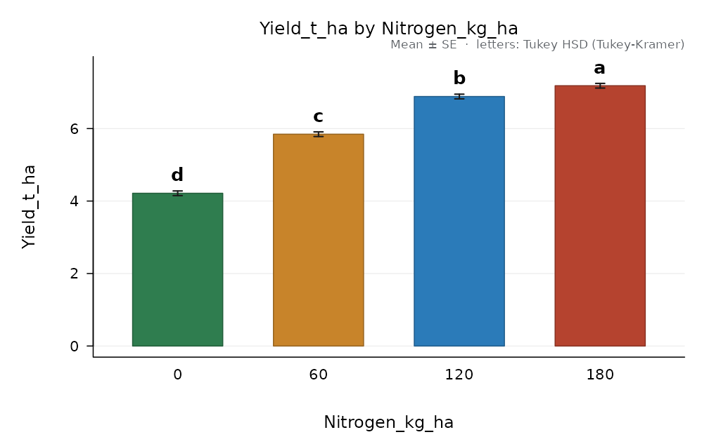
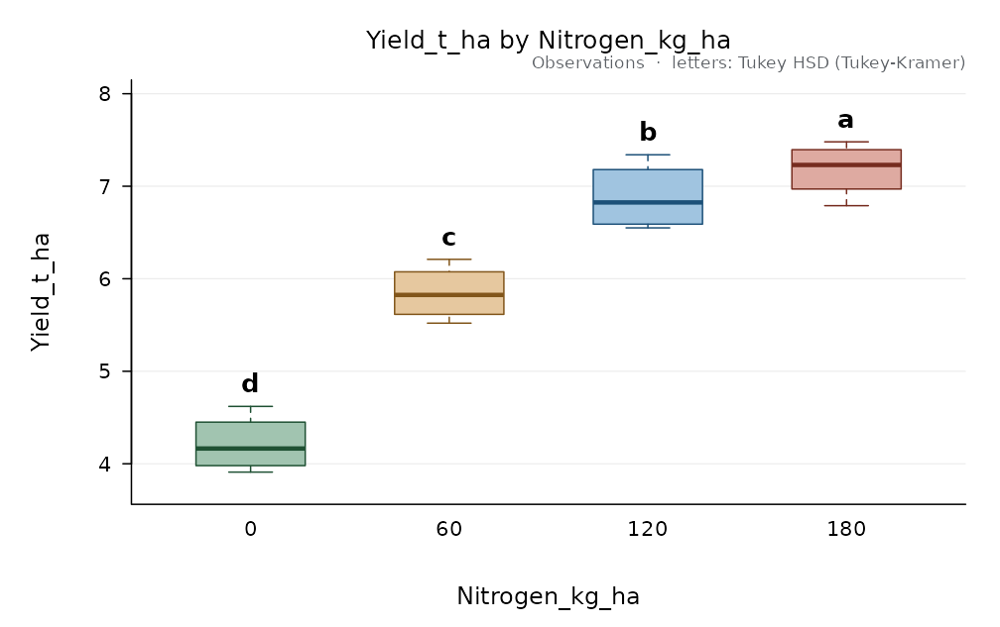
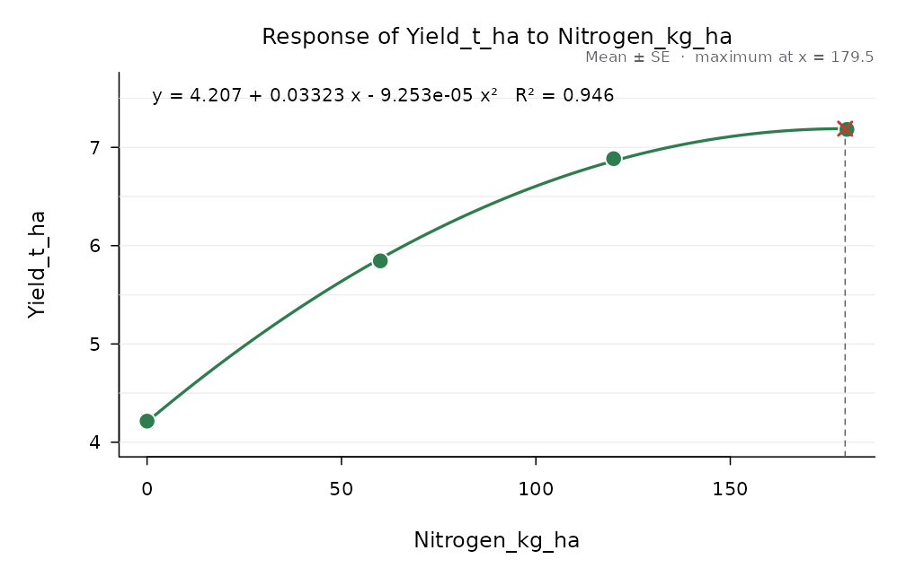

# Getting started with AgriDesign

AgriDesign follows the steps of the analysis of a field trial: fit the
model of the design, check its assumptions, compare the treatments, draw
the figures and write the report. This vignette walks through them with
a maize trial: four nitrogen rates in a randomised complete block design
with four blocks.

``` r

library(AgriDesign)
head(maize_nitrogen)
#>   Block Nitrogen_kg_ha Yield_t_ha
#> 1     1              0       4.62
#> 2     1             60       6.21
#> 3     1            120       7.34
#> 4     1            180       7.48
#> 5     2              0       3.91
#> 6     2             60       5.52
```

## 1. The analysis of variance

[`design_anova()`](https://luisangelbg.github.io/AgriDesign-R/reference/design_anova.md)
takes the data in long format (one row per plot) and the role of each
column: the response, the treatment factor(s), the blocks (or the rows
and columns of a Latin square) and, if any, covariates. When `design` is
not given, it is suggested from the roles.

``` r

fit <- design_anova(maize_nitrogen, response = "Yield_t_ha", treatment = "Nitrogen_kg_ha",
                    block = "Block")
fit
#> 
#> Randomised complete block design (RCBD)
#> Response: Yield_t_ha   (n = 16)
#> Type III sums of squares
#> 
#>                Df  Sum Sq Mean Sq F value    Pr(>F)    
#> Block           3  1.0691 0.35637   21.69 1.864e-04 ***
#> Nitrogen_kg_ha  3 21.5509 7.18362  437.27 4.591e-10 ***
#> Residuals       9  0.1479 0.01643                      
#> ---
#> Signif. codes:  0 '***' 0.001 '**' 0.01 '*' 0.05 '.' 0.1 ' ' 1
#> 
#> Grand mean = 6.03188   CV = 2.12 %   R-squared = 0.9935
```

The designs that can be analysed, and the roles each one needs, are
listed by
[`designs()`](https://luisangelbg.github.io/AgriDesign-R/reference/designs.md):

``` r

designs()[, c("id", "name")]
#>                 id
#> 1              crd
#> 2             rcbd
#> 3            grcbd
#> 4            latin
#> 5           graeco
#> 6           youden
#> 7              bib
#> 8              ibd
#> 9        augmented
#> 10        fact_crd
#> 11       fact_rcbd
#> 12      split_rcbd
#> 13       split_crd
#> 14      strip_rcbd
#> 15 splitsplit_rcbd
#> 16          nested
#>                                                                                 name
#> 1                                                 Completely randomised design (CRD)
#> 2                                            Randomised complete block design (RCBD)
#> 3                             Generalised RCBD (several plots per block x treatment)
#> 4                                                                       Latin square
#> 5                                                                Graeco-Latin square
#> 6                      Youden square (incomplete Latin square), intra-block analysis
#> 7  Incomplete blocks without replicate grouping (BIBD, cyclic), intra-block analysis
#> 8               Incomplete block design (lattice, alpha, BIBD), intra-block analysis
#> 9                        Augmented design (replicated checks + unreplicated entries)
#> 10                                                                  Factorial in CRD
#> 11                                                                 Factorial in RCBD
#> 12                                         Split-plot in RCBD (main plots in blocks)
#> 13                              Split-plot in CRD (main plots completely randomised)
#> 14                                                  Strip-plot (split-block) in RCBD
#> 15                                                          Split-split-plot in RCBD
#> 16                             Nested (hierarchical): second factor within the first
```

## 2. Assumptions

[`check_assumptions()`](https://luisangelbg.github.io/AgriDesign-R/reference/check_assumptions.md)
runs the usual checks on the residuals and summarises them in a grade
from A (satisfied) to D (several assumptions fail).

``` r

check_assumptions(fit)
#> 
#> Assumptions of the ANOVA for Yield_t_ha (alpha = 0.05)
#> 
#>  Check        Test                        Statistic    df    p      Rating
#>  normality    Shapiro-Wilk                W = 0.9304         0.2477 ok    
#>  normality    Anderson-Darling            A2 = 0.4947        0.1840       
#>  normality    Jarque-Bera                 JB = 2.303   2     0.3162       
#>  variances    Levene (median)             F = 0.5348   3, 12 0.6672 ok    
#>  variances    Levene (mean)               F = 4.27     3, 12 0.0287       
#>  variances    Bartlett                    K2 = 0.1708  3     0.9822       
#>  variances    Fligner-Killeen             X2 = 1.314   3     0.7259       
#>  variances    Hartley Fmax                Fmax = 1.549                    
#>  additivity   Tukey one-degree-of-freedom F = 0.0548   1, 8  0.8208 ok    
#>  extremes     |studentized residual| > 3  count = 0                 ok    
#>  independence Durbin-Watson (data order)  d = 2.451                 ok    
#> 
#> Observations with |studentized residual| > 2.5:
#>  row group observed fitted studentized
#>   16   180     7.31  7.056       2.646
#> 
#> Grade A. Assumptions satisfied. Proceed with the analysis of variance on this scale.
```

Observation 16 has a studentized residual of 2.65; it is worth checking
in the field book, but on its own it does not invalidate the analysis.
The residual plots show the same picture:

``` r

plot(fit)
```



When an assumption fails,
[`transformations()`](https://luisangelbg.github.io/AgriDesign-R/reference/transformations.md)
compares the candidate transformations on the same model and suggests
one, and
[`nonparametric()`](https://luisangelbg.github.io/AgriDesign-R/reference/nonparametric.md)
offers rank-based alternatives. In the tomato factorial the block and
treatment effects are multiplicative and the logarithm removes the
problem:

``` r

tom <- design_anova(tomato_factorial, "Yield_kg_plant", c("Variety", "Fertilizer"), block = "Block")
transformations(tom)$verdict
#> [1] "Suggested: Natural logarithm ln(y). It is the power closest to the Box-Cox estimate and it satisfies the checks (smallest p = 0.2204 vs 2.346e-06 on the original scale). Means are compared on the transformed scale; report them back-transformed."
tom_log <- design_anova(tomato_factorial, "Yield_kg_plant", c("Variety", "Fertilizer"),
                        block = "Block", transform = "log")
check_assumptions(tom_log)$grade
#> [1] "A"
```

## 3. Comparing the treatments

[`compare_means()`](https://luisangelbg.github.io/AgriDesign-R/reference/compare_means.md)
separates the least-squares means with one of eleven procedures and
labels them with letters: means that share a letter do not differ.

``` r

cmp <- compare_means(fit, "Nitrogen_kg_ha", method = "tukey")
cmp
#> 
#> Tukey HSD (Tukey-Kramer), alpha = 0.05
#> Response: Yield_t_ha   compared: Nitrogen_kg_ha
#> Error: Residual error (MS = 0.01643, df = 9)
#> Minimum significant difference = 0.2829
#> 
#>  Nitrogen_kg_ha n  mean      se raw_mean     sd group
#>             180 4 7.183 0.06409    7.183 0.2943     a
#>             120 4 6.885 0.06409    6.885 0.3663     b
#>              60 4 5.845 0.06409    5.845 0.2978     c
#>               0 4 4.215 0.06409    4.215 0.3101     d
#> 
#> Means sharing a letter do not differ.
```

Nitrogen rates are quantitative, so the trend is more informative than
the letters.
[`trend()`](https://luisangelbg.github.io/AgriDesign-R/reference/trend.md)
splits the sum of squares into orthogonal polynomial components and fits
the curve:

``` r

tr <- trend(fit, "Nitrogen_kg_ha")
tr
#> 
#> Trend analysis of Yield_t_ha on Nitrogen_kg_ha (error: Residual error)
#> 
#>  component coefficients        ss         F df_error         p
#>     Linear -3, -1, 1, 3 19.770661 1203.4388        9 6.788e-11
#>  Quadratic 1, -1, -1, 1  1.775556  108.0780        9 2.587e-06
#>      Cubic -1, 3, -3, 1  0.004651    0.2831        9 6.075e-01
#> 
#> Highest significant component: quadratic.
#> Fitted response: y = 4.207 + 0.03323 x - 9.253e-05 x^2   R-squared = 0.946
#> Maximum response at x = 179.5 (y = 7.19); at the edge of the levels tested
```

Planned comparisons are tested with
[`test_contrasts()`](https://luisangelbg.github.io/AgriDesign-R/reference/test_contrasts.md):

``` r

test_contrasts(fit, "Nitrogen_kg_ha", rbind("control vs fertilised" = c(3, -1, -1, -1),
                                            "120 vs 180" = c(0, 0, 1, -1)))
#>                contrast estimate         se         t            p         ss          F df_error
#> 1 control vs fertilised  -7.2675 0.22200319 -32.73602 1.139670e-10 17.6055187 1071.64674        9
#> 2            120 vs 180  -0.2975 0.09063242  -3.28249 9.491459e-03  0.1770125   10.77474        9
```

## 4. Figures

Every result has a
[`plot()`](https://rdrr.io/r/graphics/plot.default.html) method, and
[`save_figure()`](https://luisangelbg.github.io/AgriDesign-R/reference/save_figure.md)
writes it at the size and resolution a journal asks for (PNG and TIFF
carry the resolution in their header; PDF, SVG and EPS are vector
formats).

``` r

plot(cmp)
```



``` r

plot(cmp, style = "box")
```



``` r

plot(tr)
```



``` r

save_figure("figure1.tiff", plot(cmp), width = 8.5, height = 6.5, units = "cm", res = 600)
```

## 5. The report

[`design_report()`](https://luisangelbg.github.io/AgriDesign-R/reference/design_report.md)
writes all of the above in one self-contained HTML file: a materials and
methods paragraph, descriptive statistics, the assumption checks, the
analysis of variance with a draft of the results, the means with their
letters, trends, figures and appendices. Open it in a browser and print
it to PDF from there.

``` r

design_report(fit, "maize-report.html", title = "Nitrogen rates in maize",
              authors = "A. Author", units = "t/ha")
```

## Where next

- [`vignette("designs", package = "AgriDesign")`](https://luisangelbg.github.io/AgriDesign-R/articles/designs.md):
  factorials, split-plots, Latin and Graeco-Latin squares, incomplete
  blocks and covariates.
- [`vignette("planning", package = "AgriDesign")`](https://luisangelbg.github.io/AgriDesign-R/articles/planning.md):
  randomised layouts, field books and the number of replicates.
- [`vignette("breeding", package = "AgriDesign")`](https://luisangelbg.github.io/AgriDesign-R/articles/breeding.md):
  AMMI, stability, line x tester, diallels and North Carolina designs.
- [`vignette("more-tests", package = "AgriDesign")`](https://luisangelbg.github.io/AgriDesign-R/articles/more-tests.md):
  further rank-based tests and plant pathology tools.
