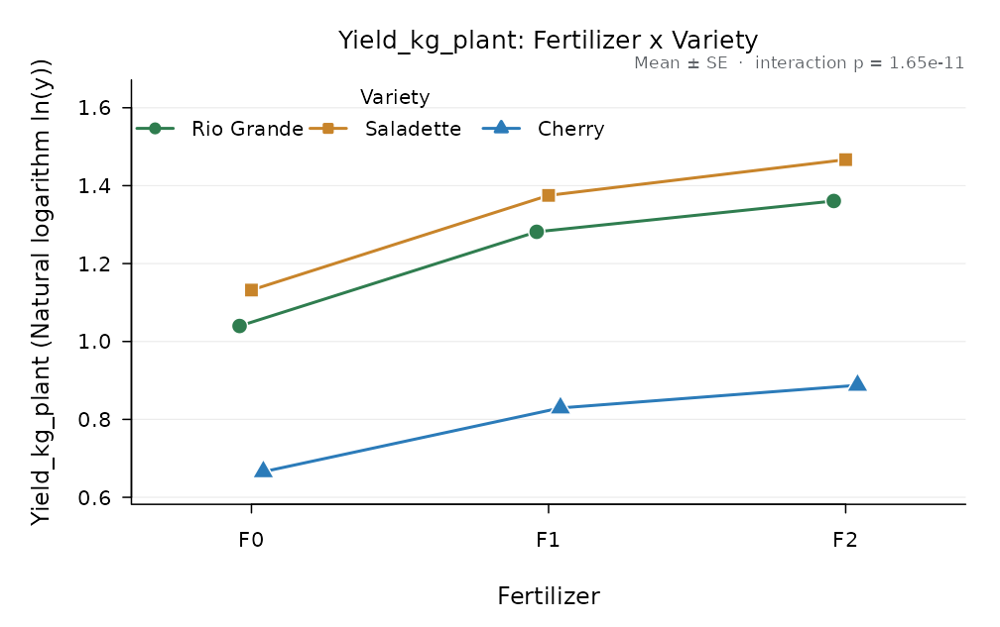
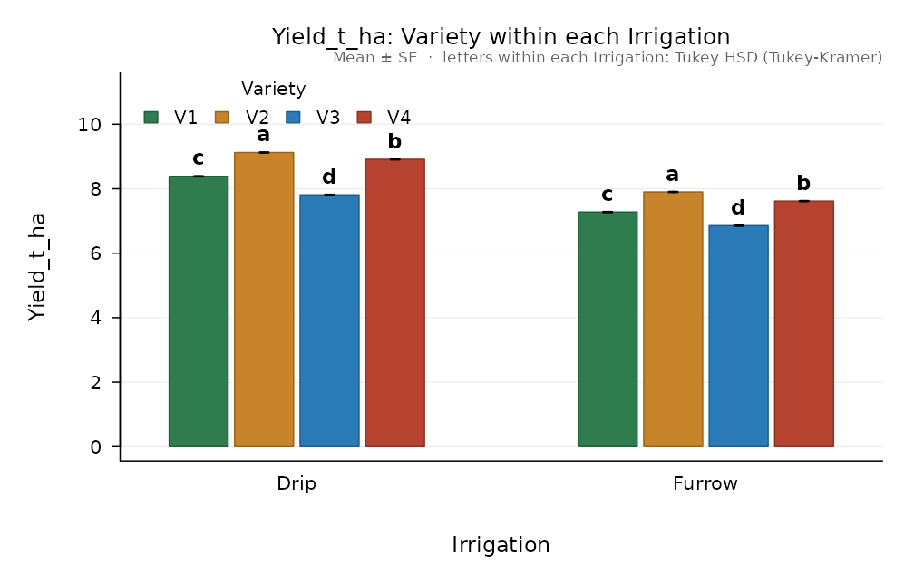
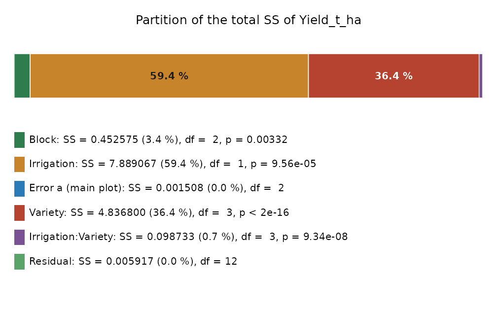
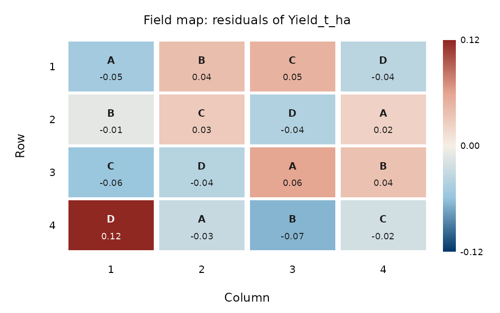

# Analysing classical designs

The model of a design is not only a list of terms: each term has to be
tested against the variation of the experimental units to which it was
applied. This vignette shows how AgriDesign handles that in the common
designs of agricultural research.

## Factorials

All combinations of two or more factors, here three tomato varieties by
three fertiliser levels in complete blocks:

``` r

fit <- design_anova(tomato_factorial, "Yield_kg_plant", c("Variety", "Fertilizer"),
                    block = "Block", transform = "log")
fit
#> 
#> Factorial in RCBD
#> Response: Yield_kg_plant, transformed: Natural logarithm ln(y)   (n = 27)
#> Type III sums of squares
#> 
#>                    Df    Sum Sq   Mean Sq F value    Pr(>F)    
#> Block               2 0.0222491 1.112e-02   408.8 1.843e-14 ***
#> Variety             2 1.4349195 7.175e-01 26363.3 7.172e-29 ***
#> Fertilizer          2 0.4143318 2.072e-01  7612.4 1.475e-24 ***
#> Variety:Fertilizer  4 0.0122763 3.069e-03   112.8 1.654e-11 ***
#> Residuals          16 0.0004354 2.721e-05                      
#> ---
#> Signif. codes:  0 '***' 0.001 '**' 0.01 '*' 0.05 '.' 0.1 ' ' 1
#> 
#> Grand mean = 1.11537   CV = 0.47 %   R-squared = 0.9998
```

With a significant interaction, the main effects are averaged over
levels that behave differently; compare one factor within each level of
the other (simple effects):

``` r

compare_means(fit, "Fertilizer", by = "Variety")
#> 
#> Tukey HSD (Tukey-Kramer), alpha = 0.05
#> Response: Yield_kg_plant   compared: Fertilizer within each level of Variety
#> Error: Residual error (MS = 2.721e-05, df = 16)
#> Minimum significant difference = 0.01099
#> 
#>     Variety Fertilizer n   mean       se raw_mean      sd back_transformed group
#>  Rio Grande         F2 3 1.3606 0.003012   1.3606 0.03220            3.899     a
#>  Rio Grande         F1 3 1.2815 0.003012   1.2815 0.03229            3.602     b
#>  Rio Grande         F0 3 1.0398 0.003012   1.0398 0.03957            2.829     c
#>   Saladette         F2 3 1.4668 0.003012   1.4668 0.03248            4.335     a
#>   Saladette         F1 3 1.3750 0.003012   1.3750 0.03466            3.955     b
#>   Saladette         F0 3 1.1320 0.003012   1.1320 0.03751            3.102     c
#>      Cherry         F2 3 0.8876 0.003012   0.8876 0.03099            2.429     a
#>      Cherry         F1 3 0.8294 0.003012   0.8294 0.04215            2.292     b
#>      Cherry         F0 3 0.6657 0.003012   0.6657 0.03601            1.946     c
#> 
#> Means sharing a letter do not differ (letters valid within each level).
plot_interaction(fit, "Fertilizer", "Variety")
```



Because the analysis was done on the log scale, the tables also report
the back-transformed means.

## Split-plots and strip-plots

Irrigation systems are hard to apply to small plots, so they go on main
plots; varieties go on sub-plots inside them. The main-plot factor is
compared with the variation among main plots (Error a), the rest with
the sub-plot error:

``` r

sp <- design_anova(split_irrigation, "Yield_t_ha", c("Irrigation", "Variety"),
                   block = "Block", design = "split_rcbd")
sp
#> 
#> Split-plot in RCBD (main plots in blocks)
#> Response: Yield_t_ha   (n = 24)
#> Type III sums of squares
#> 
#>                     Df   Sum Sq   Mean Sq  F value    Pr(>F)    
#> Block                2 0.452575 0.2262875   300.05 3.322e-03  **
#> Irrigation           1 7.889067 7.8890667 10460.64 9.558e-05 ***
#> Error a (main plot)  2 0.001508 0.0007542                       
#> Variety              3 4.836800 1.6122667  3269.95 9.749e-18 ***
#> Irrigation:Variety   3 0.098733 0.0329111    66.75 9.343e-08 ***
#> Error (residual)    12 0.005917 0.0004931                       
#> 
#> Tested against a higher error stratum:
#>   Block vs Error a (main plot)
#>   Irrigation vs Error a (main plot)
#> ---
#> Signif. codes:  0 '***' 0.001 '**' 0.01 '*' 0.05 '.' 0.1 ' ' 1
#> 
#> Grand mean = 7.985   CV = 0.28 %   R-squared = 0.9996
```

Compared as if it were a factorial in blocks, the F of irrigation would
be inflated, because the sub-plot error is much smaller than the
variation among main plots. Simple effects use the right error in each
direction: Error b for varieties within an irrigation system, and the
pooled error with Satterthwaite degrees of freedom for irrigation within
a variety.

``` r

compare_means(sp, "Variety", by = "Irrigation")$error$label
#> [1] "Error b (sub-plot)"
compare_means(sp, "Irrigation", by = "Variety")$error
#> $ms
#> [1] 0.0005583333
#> 
#> $df
#> [1] 10.68707
#> 
#> $label
#> [1] "pooled error [(b-1)Eb + Ea]/b with Satterthwaite df"
plot(compare_means(sp, "Variety", by = "Irrigation"))
```



``` r

plot_ss_partition(sp)
```



`design = "strip_rcbd"` (three error strata) and `"splitsplit_rcbd"`
work in the same way.

## Latin and Graeco-Latin squares

Two blocking directions, rows and columns:

``` r

lt <- design_anova(wheat_latin, "Yield_t_ha", "Treatment", row = "Row", col = "Column")
lt$design
#> [1] "latin"
plot_field(lt, value = "residuals")
```



A Graeco-Latin square adds a third blocking factor, given as `block`; a
Youden square (an incomplete Latin square) is suggested when the columns
do not hold every treatment.

## Incomplete blocks

When there are more treatments than plots in a block, the blocks are
incomplete. The intra-block analysis adjusts the treatment means for the
blocks:

``` r

bib <- design_anova(bib_sorghum, "Yield_t_ha", "Hybrid", block = "Block")
bib$design
#> [1] "bib"
ls_means(bib, "Hybrid")[, c("Hybrid", "mean", "se")]
#>   Hybrid     mean       se
#> 1     H1 6.543333 0.171008
#> 2     H2 6.617619 0.171008
#> 3     H4 7.213333 0.171008
#> 4     H3 6.346190 0.171008
#> 5     H5 6.729048 0.171008
#> 6     H6 5.979048 0.171008
#> 7     H7 7.114762 0.171008
```

If the blocks are a random sample of field conditions, the block totals
also carry information on the treatments.
[`recover_interblock()`](https://luisangelbg.github.io/AgriDesign-R/reference/recover_interblock.md)
estimates the block and error variances by REML and combines both
sources:

``` r

recover_interblock(bib)
#> 
#> Recovery of inter-block information (REML)
#> Incomplete blocks without replicate grouping (BIBD, cyclic), intra-block analysis
#> Variance components: blocks = 0.4998, error = 0.07047
#> Average SE of a difference: combined 0.2442, intra-block 0.2458
#> Relative efficiency of the combined analysis: 101.3 % of the intra-block analysis
#> 
#>  level n  mean     se intra_mean
#>     H1 3 6.541 0.3167      6.543
#>     H2 3 6.611 0.3167      6.618
#>     H4 3 7.245 0.3167      7.213
#>     H3 3 6.334 0.3167      6.346
#>     H5 3 6.711 0.3167      6.729
#>     H6 3 5.964 0.3167      5.979
#>     H7 3 7.138 0.3167      7.115
```

Resolvable designs (alpha, lattice) are analysed with two block columns:
replicate and block within replicate (`block = c("Rep", "Block")`).

## Covariates

A covariate measured on every plot (stand count, initial weight) enters
with `covariate =`; the treatment means are then adjusted to its mean:

``` r

d <- maize_nitrogen
d$Stand <- c(58, 61, 63, 57, 60, 62, 59, 64, 55, 61, 60, 62, 63, 58, 59, 60)
anc <- design_anova(d, "Yield_t_ha", "Nitrogen_kg_ha", block = "Block", covariate = "Stand")
ls_means(anc, "Nitrogen_kg_ha")[, c("Nitrogen_kg_ha", "mean", "se", "raw_mean")]
#>   Nitrogen_kg_ha     mean         se raw_mean
#> 1              0 4.214789 0.07028340   4.2150
#> 2             60 5.845070 0.06823422   5.8450
#> 3            120 6.885023 0.06800272   6.8850
#> 4            180 7.182617 0.06869487   7.1825
```
