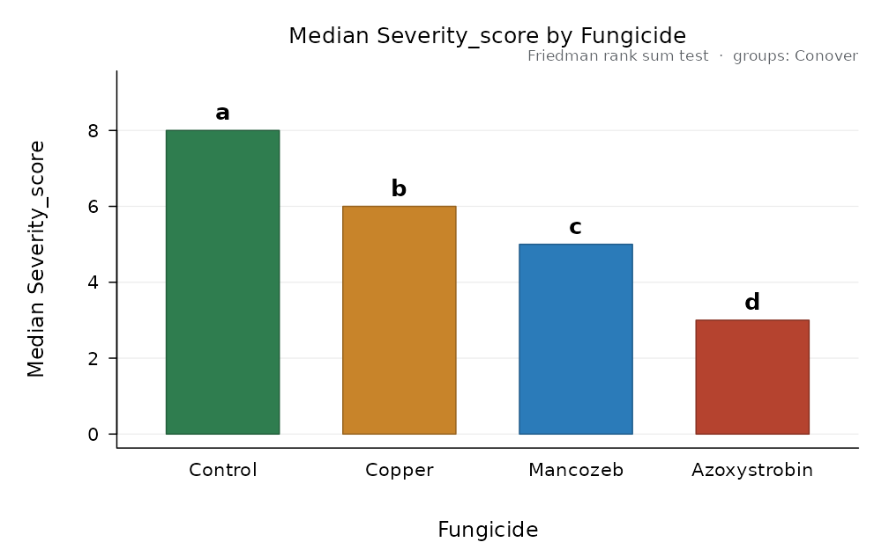
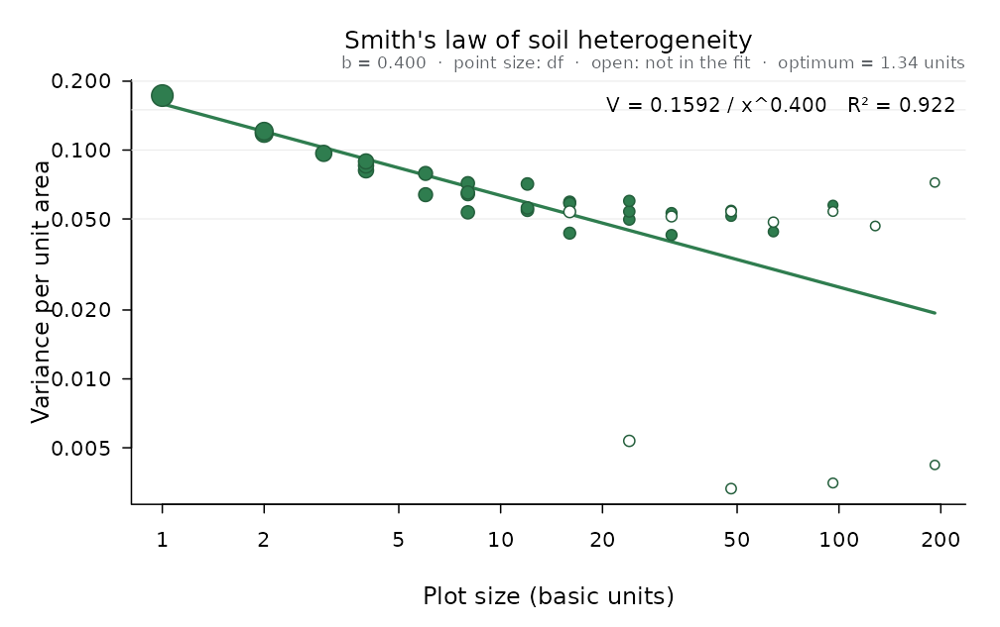

# Rank-based tests and plant pathology

## When the assumptions fail

[`nonparametric()`](https://luisangelbg.github.io/AgriDesign-R/reference/nonparametric.md)
picks the rank-based alternative that fits the design: Kruskal-Wallis
for a completely randomised design, Friedman for complete blocks,
Scheirer-Ray-Hare for two factors, the aligned rank transform for
factorials in blocks, and Welch’s ANOVA when only the variances differ.
Ordinal scores, like disease severity, are a typical case:

``` r

dz <- design_anova(disease_scores, "Severity_score", "Fungicide", block = "Block")
np <- nonparametric(dz)
np
#> 
#> Friedman rank sum test
#> Response: Severity_score   factor: Fungicide
#> chisq = 14.04, df = 3, p = 0.002851
#> Kendall_W = 0.936
#> Iman-Davenport F = 58.5 on 3 and 12 df, p = 1.959e-07
#> 
#> Pairwise comparisons: Conover (p adjusted by holm)
#>       level_i      level_j statistic         p     p_adj different
#>       Control     Mancozeb     7.794 4.904e-06 2.452e-05      TRUE
#>       Control Azoxystrobin    12.990 1.989e-08 1.193e-07      TRUE
#>       Control       Copper     5.196 2.233e-04 6.699e-04      TRUE
#>      Mancozeb Azoxystrobin     5.196 2.233e-04 6.699e-04      TRUE
#>      Mancozeb       Copper     2.598 2.331e-02 2.331e-02      TRUE
#>  Azoxystrobin       Copper     7.794 4.904e-06 2.452e-05      TRUE
#> 
#> Groups (levels sharing a letter do not differ at alpha = 0.05):
#>         level n median mean mean_rank group
#>       Control 5      8  7.8       4.0     a
#>        Copper 5      6  5.8       2.8     b
#>      Mancozeb 5      5  4.8       2.2     c
#>  Azoxystrobin 5      3  2.6       1.0     d
plot(np)
```



Further tests: Durbin’s test for balanced incomplete blocks, the van der
Waerden normal-scores test and Mood’s median test.

``` r

durbin_test(bib_sorghum, "Yield_t_ha", "Hybrid", "Block")$test
#> $name
#> [1] "Durbin rank test for balanced incomplete blocks"
#> 
#> $statistic
#>    chisq 
#> 10.44444 
#> 
#> $df
#> [1] 6
#> 
#> $p
#> [1] 0.1071405
#> 
#> $effect
#> NULL
#> 
#> $F_form
#>          F        df1        df2          p 
#> 3.91666667 6.00000000 8.00000000 0.03972924
waerden_test(bean_varieties, "Yield_kg_plot", "Variety")$test
#> $name
#> [1] "van der Waerden normal-scores test"
#> 
#> $statistic
#>  chisq 
#> 17.069 
#> 
#> $df
#> [1] 4
#> 
#> $p
#> [1] 0.001874183
#> 
#> $effect
#> NULL
```

## The Waller-Duncan test

A Bayesian alternative to the multiple range tests: the critical
difference adapts to the F of the treatments (large F, more liberal;
small F, more conservative). The result works with
[`print()`](https://rdrr.io/r/base/print.html) and
[`plot()`](https://rdrr.io/r/graphics/plot.default.html) like any other
comparison:

``` r

fit <- design_anova(maize_nitrogen, "Yield_t_ha", "Nitrogen_kg_ha", block = "Block")
waller_duncan(fit, "Nitrogen_kg_ha")
#> 
#> Waller-Duncan k-ratio t test (K = 100), alpha = 0.0672
#> Response: Yield_t_ha   compared: Nitrogen_kg_ha
#> Error: Residual error (MS = 0.01643, df = 9)
#> Bayesian k-ratio rule: K = 100, F = 437.3 on 3 and 9 df, critical t = 2.0803 (comparison-wise alpha about 0.067). 
#> Minimum significant difference = 0.1885
#> 
#>  Nitrogen_kg_ha n  mean      se raw_mean     sd group
#>             180 4 7.183 0.06409    7.183 0.2943     a
#>             120 4 6.885 0.06409    6.885 0.3663     b
#>              60 4 5.845 0.06409    5.845 0.2978     c
#>               0 4 4.215 0.06409    4.215 0.3101     d
#> 
#> Means sharing a letter do not differ.
```

## Disease progress

The area under the disease progress curve (AUDPC) and its stairs version
(AUDPS, which weighs the first and last assessments better) summarise an
epidemic in one number per plot, ready for the analysis of variance:

``` r

head(blight_progress)
#>   Block Treatment Day Severity_pct
#> 1     1 Untreated  21         23.9
#> 2     1 Untreated  28         55.5
#> 3     1 Untreated  35         80.3
#> 4     1 Untreated  42        100.0
#> 5     1 Untreated  49        100.0
#> 6     1 Untreated  56        100.0
a <- audpc_by_unit(blight_progress, "Severity_pct", "Day", c("Block", "Treatment"))
head(a)
#>   Block  Treatment n duration   audpc  audps audpc_rel audps_rel audpc_std audps_std
#> 1     1  Untreated 7       42 3484.25 3917.9 0.8295833 0.7995714  82.95833  79.95714
#> 2     1    Contact 7       42 2480.80 2856.7 0.5906667 0.5830000  59.06667  58.30000
#> 3     1   Systemic 7       42 1948.10 2294.6 0.4638333 0.4682857  46.38333  46.82857
#> 4     1 Alternated 7       42 1693.65 2005.5 0.4032500 0.4092857  40.32500  40.92857
#> 5     2  Untreated 7       42 3259.20 3659.6 0.7760000 0.7468571  77.60000  74.68571
#> 6     2    Contact 7       42 2489.55 2849.7 0.5927500 0.5815714  59.27500  58.15714
fa <- design_anova(a, "audps", "Treatment", block = "Block")
compare_means(fa, "Treatment")
#> 
#> Tukey HSD (Tukey-Kramer), alpha = 0.05
#> Response: audps   compared: Treatment
#> Error: Residual error (MS = 20409, df = 9)
#> Minimum significant difference = 315.4
#> 
#>   Treatment n mean    se raw_mean     sd group
#>   Untreated 4 3591 71.43     3591 252.38     a
#>     Contact 4 2898 71.43     2898  87.68     b
#>    Systemic 4 2105 71.43     2105 159.93     c
#>  Alternated 4 1788 71.43     1788 225.57     d
#> 
#> Means sharing a letter do not differ.
```

## Soil heterogeneity and plot size

From a uniformity trial (one crop, no treatments, harvested in small
basic units), Smith’s law relates the variance per unit area to the plot
size. The index b (between 0 and 1) measures how correlated neighbouring
units are and gives the optimum plot size for a cost ratio:

``` r

sm <- smith_index(uniformity_trial, cost_ratio = 2)
sm
#> 
#> Smith's index of soil heterogeneity
#> Uniformity trial: 24 x 16 basic units, mean = 4.998, CV of the basic units = 8.32 %
#> 
#>  size width length plots  df variance    cv  used
#>     1     1      1   384 383 0.173010 8.321  TRUE
#>     2     1      2   192 191 0.118250 6.880  TRUE
#>     2     2      1   192 191 0.120846 6.955  TRUE
#>     3     1      3   128 127 0.096731 6.222  TRUE
#>     4     1      4    96  95 0.081564 5.714  TRUE
#>     4     2      2    96  95 0.085626 5.854  TRUE
#>     4     4      1    96  95 0.089201 5.975  TRUE
#>     6     1      6    64  63 0.063830 5.054  TRUE
#>     6     2      3    64  63 0.079055 5.625  TRUE
#>     8     1      8    48  47 0.053451 4.625  TRUE
#>     8     2      4    48  47 0.064212 5.070  TRUE
#>     8     4      2    48  47 0.071609 5.354  TRUE
#>     8     8      1    48  47 0.065258 5.111  TRUE
#>    12     1     12    32  31 0.054553 4.673  TRUE
#>    12     2      6    32  31 0.055863 4.729  TRUE
#>    12     4      3    32  31 0.071087 5.334  TRUE
#>    16     2      8    24  23 0.043345 4.165  TRUE
#>    16     4      4    24  23 0.059299 4.872  TRUE
#>    16     8      2    24  23 0.058465 4.837  TRUE
#>    16    16      1    24  23 0.053755 4.638 FALSE
#>    24     1     24    16  15 0.005359 1.464 FALSE
#>    24     2     12    16  15 0.049709 4.460  TRUE
#>    24     4      6    16  15 0.053903 4.645  TRUE
#>    24     8      3    16  15 0.059940 4.898  TRUE
#>    32     4      8    12  11 0.042554 4.127  TRUE
#>    32     8      4    12  11 0.053080 4.609  TRUE
#>    32    16      2    12  11 0.051262 4.530 FALSE
#>    48     2     24     8   7 0.003315 1.152 FALSE
#>    48     4     12     8   7 0.051453 4.538  TRUE
#>    48     8      6     8   7 0.054437 4.668  TRUE
#>    48    16      3     8   7 0.053916 4.645 FALSE
#>    64     8      8     6   5 0.043974 4.195  TRUE
#>    64    16      4     6   5 0.048435 4.403 FALSE
#>    96     4     24     4   3 0.003507 1.185 FALSE
#>    96     8     12     4   3 0.057465 4.796  TRUE
#>    96    16      6     4   3 0.053906 4.645 FALSE
#>   128    16      8     3   2 0.046586 4.318 FALSE
#>   192     8     24     2   1 0.004206 1.297 FALSE
#>   192    16     12     2   1 0.072141 5.373 FALSE
#> 
#> Fit of V_x = V_1 / x^b on the log scale (weighted by df, 28 shapes with 'used' TRUE; strips spanning the whole field left out):
#>   V_1 = 0.1592, b = 0.4004, R-squared = 0.9219
#> Intermediate b: adjacent units are moderately correlated.
#> Optimum plot size (Smith, cost per plot / cost per unit area = 2): 1.335 basic units
plot(sm)
```


