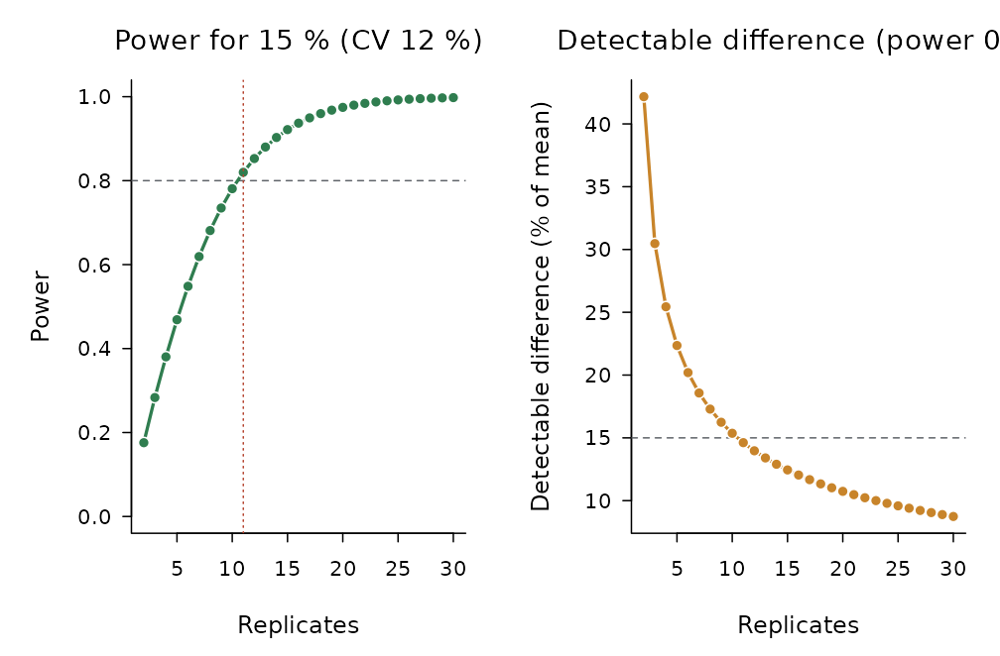
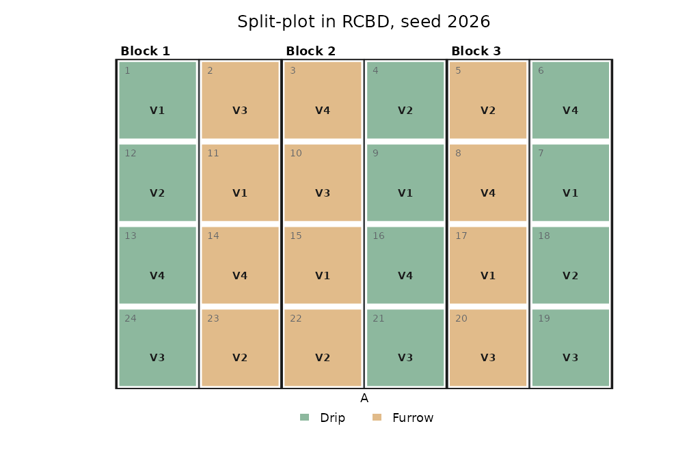
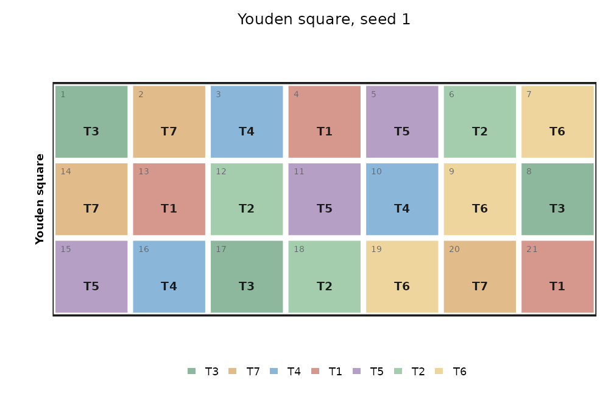

# Planning an experiment

Before the trial: how many replicates, which design, and where each
treatment goes in the field.

## How many replicates?

The number of replicates depends on the coefficient of variation
expected (take it from earlier trials of the same crop and site) and on
the smallest difference worth detecting.
[`power_design()`](https://luisangelbg.github.io/AgriDesign-R/reference/power_design.md)
uses the noncentral t distribution with the error degrees of freedom of
the design:

``` r

pw <- power_design(cv = 12, diff = 15, t = 6, design = "rcbd")
pw
#> 
#> Replicates to detect a difference of 15 % of the mean (CV 12 %, 6 treatments, RCBD, alpha 0.05, power 0.8)
#> Replicates needed: 11 (error df 50)
#> 
#>  Replicates Error df Power Detectable diff. (%)
#>           2        5 0.176                 42.2
#>           3       10 0.283                 30.5
#>           4       15 0.380                 25.4
#>           5       20 0.469                 22.4
#>           6       25 0.548                 20.2
#>           7       30 0.619                 18.6
#>           8       35 0.681                 17.3
#>           9       40 0.735                 16.2
#>          10       45 0.781                 15.4
#>          11       50 0.820                 14.6
#>          12       55 0.853                 14.0
#>          13       60 0.880                 13.4
#>          14       65 0.903                 12.9
#>          15       70 0.922                 12.4
#>          16       75 0.937                 12.0
#> 
#> Halving the CV is worth as much as quadrupling the replicates.
plot(pw)
```



Halving the coefficient of variation is worth as much as quadrupling the
replicates: uniform land, plots of the right size, border rows and
blocks laid across the gradient are usually cheaper than more plots.

## Randomising the layout

[`make_design()`](https://luisangelbg.github.io/AgriDesign-R/reference/make_design.md)
randomises sixteen designs. `designs("layout")` lists them with the
arguments each one needs, its conditions and the design of
[`design_anova()`](https://luisangelbg.github.io/AgriDesign-R/reference/design_anova.md)
that analyses its field book:

``` r

designs("layout")[, c("id", "name", "needs", "analyse_as")]
#>            id                                                                     name
#> 1         crd                                       Completely randomised design (CRD)
#> 2        rcbd                                  Randomised complete block design (RCBD)
#> 3       latin                                                             Latin square
#> 4    fact_crd                                                         Factorial in CRD
#> 5   fact_rcbd                                                        Factorial in RCBD
#> 6  split_rcbd                                                       Split-plot in RCBD
#> 7       strip                                         Strip-plot (split-block) in RCBD
#> 8  splitsplit                                                 Split-split-plot in RCBD
#> 9         ibd Resolvable incomplete blocks (random blocks of size k within replicates)
#> 10  augmented          Augmented design (checks in every block + unreplicated entries)
#> 11     graeco                                                      Graeco-Latin square
#> 12     youden                                                            Youden square
#> 13        bib                                  Balanced incomplete block design (BIBD)
#> 14     cyclic                                           Cyclic incomplete block design
#> 15      alpha                              Alpha design (resolvable incomplete blocks)
#> 16    lattice                                                           Square lattice
#>                 needs      analyse_as
#> 1              trt, r             crd
#> 2              trt, r            rcbd
#> 3                 trt           latin
#> 4         A, B (C), r        fact_crd
#> 5         A, B (C), r       fact_rcbd
#> 6             A, B, r      split_rcbd
#> 7             A, B, r      strip_rcbd
#> 8          A, B, C, r splitsplit_rcbd
#> 9           trt, k, r             ibd
#> 10 checks, entries, r       augmented
#> 11        trt (greek)          graeco
#> 12             trt, k          youden
#> 13             trt, k             bib
#> 14          trt, k, r             bib
#> 15          trt, k, r             ibd
#> 16          trt, k, r             ibd
```

The randomisation is reproducible with `seed` and does not change the
random state of the session. Printing the layout shows, at the end, the
call that analyses it once the responses are in the field book.

``` r

lay <- make_design("rcbd", trt = c("N0", "N60", "N120", "N180", "N240"), r = 4, seed = 2026)
lay
#> 
#> Randomised complete block design (RCBD)
#> 20 plots in 4 field rows x 5 columns; 5 treatments; replicates 4; seed 2026
#> 
#> Skeleton ANOVA
#>      source df
#>      Blocks  3
#>  Treatments  4
#>       Error 12
#>       Total 19
#> 
#> Field book (first rows):
#>  Plot Block FieldRow FieldCol Treatment
#>     1     1        1        1      N240
#>     2     1        1        2        N0
#>     3     1        1        3      N180
#>     4     1        1        4       N60
#>     5     1        1        5      N120
#>     6     2        2        5       N60
#>     7     2        2        4      N240
#>     8     2        2        3        N0
#> 
#> Analysis, once the responses are in the field book:
#>   design_anova(data, "response", "Treatment", block = "Block", design = "rcbd")
plot(lay)
```


Split-plots keep the main plots together and randomise inside them:

``` r

sp <- make_design("split_rcbd", A = c("Drip", "Furrow"), B = paste0("V", 1:4), r = 3,
                  seed = 2026, arrangement = "side", blocks_per_row = 3)
plot(sp)
```



## Incomplete blocks

With many entries, complete blocks become large and heterogeneous. Alpha
designs split each replicate into small blocks;
[`make_design()`](https://luisangelbg.github.io/AgriDesign-R/reference/make_design.md)
searches the alpha array with the highest efficiency factor, which
[`design_efficiency()`](https://luisangelbg.github.io/AgriDesign-R/reference/design_efficiency.md)
reports together with the upper bound of Patterson and Williams:

``` r

al <- make_design("alpha", trt = 30, k = 5, r = 3, seed = 2026)
design_efficiency(al)[c("E", "upper_bound")]
#> $E
#> [1] 0.7843459
#> 
#> $upper_bound
#> [1] 0.7945205
```

Balanced incomplete blocks, Youden squares, cyclic designs and square
lattices are also available:

``` r

design_efficiency(make_design("bib", trt = 7, k = 3, seed = 1))$E
#> [1] 0.7777778
plot(make_design("youden", trt = 7, k = 3, seed = 1))
```



## The field book

The field book has one row per plot, with the plot number, the field
position, the block and the treatment. Add the columns of the responses
to be measured, write it to CSV, and after the harvest it goes straight
into
[`design_anova()`](https://luisangelbg.github.io/AgriDesign-R/reference/design_anova.md):

``` r

book <- field_book(lay, c("Yield", "Height"))
head(book)
#>   Plot Block FieldRow FieldCol Treatment Yield Height
#> 1    1     1        1        1      N240    NA     NA
#> 2    2     1        1        2        N0    NA     NA
#> 3    3     1        1        3      N180    NA     NA
#> 4    4     1        1        4       N60    NA     NA
#> 5    5     1        1        5      N120    NA     NA
#> 6    6     2        2        5       N60    NA     NA
```

``` r

field_book(lay, c("Yield", "Height"), file = "field-book.csv")
```
